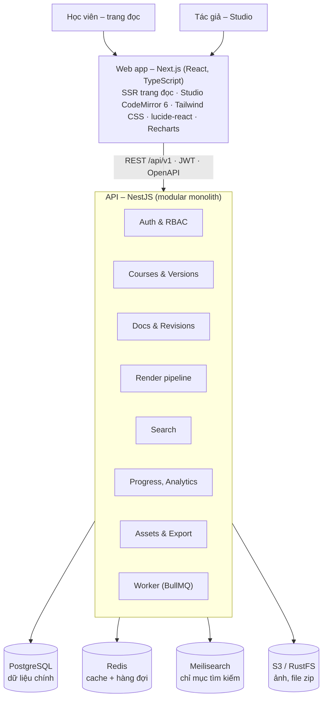
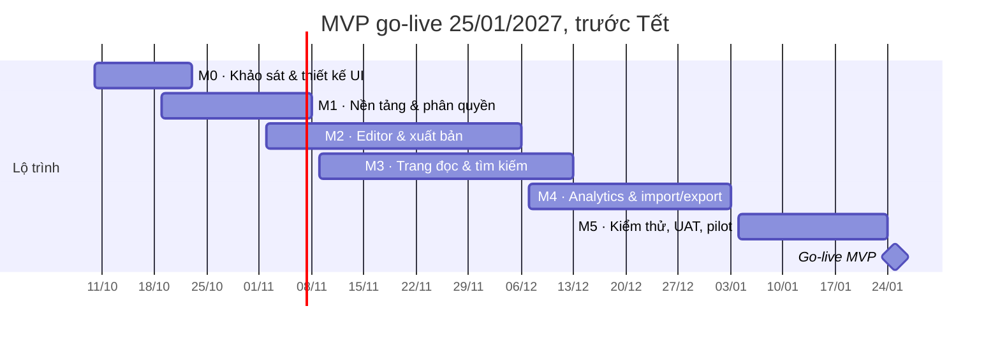

# PRD – Nền tảng tài liệu học viên (DocsHub)

08/10/2026 · Ngô Thanh Tùng

> Bản gốc: [Claude Doc](https://claude.ai/code/artifact/278d91e1-a224-414b-a98d-8434b86761fa) (rev 59). Sửa ở bản gốc rồi xuất lại, không sửa tay file này.

## 1. Tổng quan

DocsHub là nền tảng web cho giảng viên viết tài liệu khoá học bằng Markdown và cho học viên đọc, tra cứu, theo dõi tiến độ — tổ chức nội dung theo mô hình Docusaurus (khoá học → phiên bản → sidebar → bài) nhưng có editor trực tuyến, phân quyền và analytics.

**Vấn đề hiện tại**

- Tài liệu khoá học nằm rải rác ở Google Docs, Notion, PDF: khó cập nhật, không có cấu trúc thống nhất.
- Docusaurus thuần cần Git + build + deploy: giảng viên không chuyên kỹ thuật khó tự cập nhật.
- Không biết học viên đọc tới đâu, bài nào khó, bài nào bị bỏ qua.

**Mục tiêu sản phẩm**

1. Giảng viên tạo và xuất bản một bài Markdown trong dưới 5 phút, không cần Git hay build.
2. Học viên có trải nghiệm đọc ngang Docusaurus: sidebar, mục lục trang, tìm kiếm, dark mode, prev/next.
3. Giảng viên và admin thấy tiến độ học và mức độ tương tác qua dashboard.
4. Nội dung xuất/nhập được dưới dạng thư mục tương thích Docusaurus, không bị khoá vào nền tảng.

**Chỉ số thành công (6 tháng sau go-live)**

| Chỉ số | Mục tiêu |
| --- | --- |
| Thời gian từ tạo bài tới xuất bản (trung vị) | ≤ 5 phút |
| Tỷ lệ học viên hoạt động hằng tuần / tổng học viên đã ghi danh | ≥ 60% |
| Tỷ lệ hoàn thành khoá (đọc ≥ 90% số bài) | ≥ 40% |
| Thời gian tải trang bài (LCP, mạng 4G) | ≤ 2,0 giây |
| Tìm kiếm trả kết quả | ≤ 200 ms (p95) |

## 2. Người dùng & vai trò

Bốn vai trò, phân quyền theo RBAC ở cấp hệ thống và cấp khoá học (một người có thể là tác giả khoá A và học viên khoá B).

| Vai trò | Mô tả | Quyền chính |
| --- | --- | --- |
| Admin | Vận hành hệ thống | Quản lý user, khoá học, cấu hình, xem toàn bộ analytics |
| Tác giả (Owner) | Giảng viên chịu trách nhiệm khoá | Tạo khoá, sửa/xuất bản mọi bài, mời cộng tác viên, ghi danh học viên, xem analytics khoá |
| Biên tập (Editor) | Trợ giảng, cộng tác viên | Soạn, sửa bản nháp; gửi duyệt; không xuất bản |
| Học viên (Learner) | Người học | Đọc bài đã xuất bản, tìm kiếm, đánh dấu hoàn thành, ghi chú, bookmark, góp ý |

**User stories chính**

- Là tác giả, tôi muốn viết Markdown với preview trực tiếp để thấy đúng giao diện học viên sẽ đọc.
- Là tác giả, tôi muốn kéo-thả để sắp xếp bài và nhóm bài trong sidebar.
- Là tác giả, tôi muốn dán ảnh vào editor và ảnh tự được upload.
- Là tác giả, tôi muốn tạo phiên bản mới của khoá (ví dụ K2026) mà không phá tài liệu của lớp cũ.
- Là tác giả, tôi muốn xem lịch sử sửa đổi và khôi phục bản trước.
- Là biên tập, tôi muốn gửi bài để tác giả duyệt trước khi xuất bản.
- Là học viên, tôi muốn tìm nhanh một khái niệm trong toàn khoá bằng Ctrl/⌘+K.
- Là học viên, tôi muốn thấy mình đã hoàn thành bao nhiêu % khoá và bài đang đọc dở.
- Là học viên, tôi muốn ghi chú riêng và bookmark đoạn quan trọng.
- Là admin/tác giả, tôi muốn biết bài nào có tỷ lệ bỏ ngang cao để viết lại.

## 3. Phạm vi

MVP tập trung vào vòng lặp cốt lõi: viết → tổ chức → xuất bản → đọc → đo tiến độ. Quiz, bình luận và AI để sang phase 2.

| Hạng mục | MVP | Phase 2 | Ngoài phạm vi |
| --- | --- | --- | --- |
| Khoá học, sidebar, bài Markdown | ✓ |  |  |
| Editor Markdown + live preview | ✓ |  |  |
| Admonitions, code block, tabs, bảng, ảnh | ✓ |  |  |
| Mermaid, công thức toán (KaTeX) | ✓ |  |  |
| Phiên bản khoá (versioning) | ✓ |  |  |
| Lịch sử bài (revision) + khôi phục | ✓ |  |  |
| Quy trình duyệt (Draft → Review → Published) | ✓ |  |  |
| Tìm kiếm toàn khoá | ✓ |  |  |
| Tiến độ học, bookmark, ghi chú cá nhân | ✓ |  |  |
| Dashboard analytics (Recharts) | ✓ |  |  |
| Nhập từ Docusaurus/Mintlify (.zip, thư mục); export thư mục Docusaurus (.zip) | ✓ |  |  |
| Thành phần soạn thảo kiểu Mintlify (steps, accordion, card, code group, frame, tree…) | ✓ |  |  |
| Theme giao diện (10 theme kiểu Mintlify, màu chính riêng của khoá, theme tự chọn của người dùng) | ✓ |  |  |
| Đồng bộ hai chiều với Git (GitHub/GitLab) |  | ✓ |  |
| Quiz cuối bài, bài tập |  | ✓ |  |
| Bình luận / hỏi đáp theo đoạn |  | ✓ |  |
| Đa ngôn ngữ nội dung (i18n bài viết) |  | ✓ |  |
| Trợ lý AI (tóm tắt, hỏi đáp trên tài liệu) |  | ✓ |  |
| Soạn thảo cộng tác real-time |  | ✓ |  |
| Thành phần tài liệu API kiểu Mintlify (ParamField, ResponseField, ví dụ request/response), Update/changelog, Tiles, Panel, Banner |  | ✓ |  |
| Bố cục trang khác nhau theo theme (như Mintlify) |  | ✓ |  |
| MDX với React component tuỳ ý do tác giả viết |  |  | ✓ (rủi ro bảo mật) |
| Thanh toán, bán khoá học |  |  | ✓ |
| Video hosting, livestream |  |  | ✓ (chỉ nhúng YouTube/Vimeo) |
| App mobile native |  |  | ✓ (web responsive) |

## 4. Tính năng chi tiết (MVP)

Tám nhóm tính năng; mỗi yêu cầu có mã để truy vết sang ticket.

### 4.1 Tổ chức nội dung kiểu Docusaurus

- **F-ORG-01** Phân cấp: Khoá học → Phiên bản → Category (lồng tối đa 3 cấp) → Bài (Doc).
- **F-ORG-02** Sidebar tự sinh từ cây thư mục, thứ tự theo `sidebar_position`; kéo-thả trong UI ghi lại giá trị này.
- **F-ORG-03** Category có trang giới thiệu riêng (generated index hoặc doc index), icon lucide, nhãn, trạng thái thu gọn mặc định.
- **F-ORG-04** Slug tự sinh từ tiêu đề (bỏ dấu tiếng Việt), cho phép ghi đè; URL dạng `/courses/{course}/{version}/{...path}`.
- **F-ORG-05** Versioning: “cắt phiên bản” sao chép toàn bộ cây sang version mới; học viên thấy version được gán cho lớp của mình, có dropdown chuyển version.
- **F-ORG-06** Prev/Next tự động theo thứ tự sidebar; breadcrumb.

### 4.2 Editor Markdown

- **F-EDT-01** Editor CodeMirror 6 chia 2 cột: soạn thảo | preview render bằng chính pipeline của trang đọc.
- **F-EDT-02** Toolbar (icon lucide): heading, đậm/nghiêng, link, ảnh, code block, bảng, admonition, tabs; phím tắt chuẩn.
- **F-EDT-03** Slash command `/` chèn nhanh khối (tip, warning, code, mermaid, bảng…).
- **F-EDT-04** Dán/kéo-thả ảnh → upload lên object storage → chèn ``; tối đa 10 MB/ảnh (PNG, JPEG, GIF, WebP, AVIF; không nhận SVG vì có thể chứa script), tự chuyển WebP; Markdown lưu đường dẫn cố định /api/v1/assets/<id>, mỗi lần xem API kiểm tra quyền rồi chuyển hướng tới URL ký mới.
- **F-EDT-05** Form frontmatter (title, description, tags, sidebar_label, sidebar_position, thời lượng đọc) đồng bộ với YAML trong file.
- **F-EDT-06** Autosave bản nháp sau 2 giây ngừng gõ, Ctrl/⌘+S lưu thành revision; cảnh báo khi 2 người cùng sửa một bài (khoá mềm).
- **F-EDT-07** Lint khi lưu: link nội bộ hỏng, ảnh thiếu alt, heading nhảy cấp, id video nhúng sai.

### 4.3 Cú pháp Markdown hỗ trợ

- GFM: bảng, task list, strikethrough, autolink, footnote.
- Admonitions kiểu Docusaurus: `:::note`, `:::tip`, `:::info`, `:::warning`, `:::danger` (có tiêu đề tuỳ chọn).
- Code block: highlight bằng Shiki, `title="app.module.ts"`, đánh số dòng (showLineNumbers), highlight dòng `{2,4-6}`, nút copy.
- Tabs bằng directive `::::tabs` / `:::tab{label="npm"}` (không dùng JSX).
- Mermaid diagram, công thức KaTeX, nhúng YouTube/Vimeo bằng `::youtube{id="..."}` / `::vimeo{id="..."}`.
- Link nội bộ bằng đường dẫn file tương đối (`./02-provider.md`), tự đổi sang URL.

- Thành phần kiểu Mintlify (steps, accordion, card, code group, frame, cây thư mục, badge, icon, tooltip, chú thích trong code): xem mục 4.7.

### 4.4 Quy trình xuất bản & lịch sử

- **F-PUB-01** Trạng thái bài: Draft → In review → Published → Archived.
- **F-PUB-02** Mỗi lần lưu (Ctrl/⌘+S) tạo 1 revision, autosave chỉ ghi bản nháp; xem diff hai revision cạnh nhau; khôi phục 1 click.
- **F-PUB-03** Bản Published và bản nháp tồn tại song song: sửa bài đã xuất bản không ảnh hưởng học viên cho tới khi xuất bản lại.
- **F-PUB-04** Hẹn giờ xuất bản (mở bài theo lịch học).

### 4.5 Trải nghiệm đọc của học viên

- **F-RD-01** Layout 3 cột: sidebar | nội dung | mục lục trang (TOC từ h2–h3, highlight mục đang đọc).
- **F-RD-02** Tìm kiếm Ctrl/⌘+K: gợi ý theo tiêu đề, heading, nội dung; hỗ trợ gõ không dấu; mỗi kết quả là một mục h2/h3, Enter mở thẳng tới mục đó.
- **F-RD-03** Dark/light mode, chỉnh cỡ chữ, thời lượng đọc ước tính.
- **F-RD-04** Tiến độ: tự đánh dấu “đã đọc” khi cuộn ≥ 90% và ở lại ≥ 30 giây, hoặc bấm “Hoàn thành”; icon check trên sidebar; thanh % khoá.
- **F-RD-05** “Tiếp tục đọc” đưa về đúng vị trí cuộn lần trước.
- **F-RD-06** Bookmark heading, ghi chú cá nhân gắn vào đoạn văn (chỉ chủ sở hữu thấy).
- **F-RD-07** Nút “Bài này có hữu ích?” (Có/Không + góp ý ngắn) gửi về tác giả.

### 4.6 Dashboard analytics (Recharts)

| Biểu đồ | Loại | Người xem |
| --- | --- | --- |
| Học viên hoạt động theo ngày/tuần | Line chart | Tác giả, Admin |
| Tỷ lệ hoàn thành theo từng bài (rơi rớt dọc khoá) | Bar chart ngang | Tác giả |
| Thời gian đọc trung bình / bài | Bar chart | Tác giả |
| Phân bố % hoàn thành khoá của học viên | Histogram | Tác giả |
| Từ khoá tìm kiếm không có kết quả | Bảng top 20 | Tác giả |
| Đánh giá hữu ích theo bài | Stacked bar | Tác giả |
| Tiến độ cá nhân theo category | Radial bar | Học viên |
| Tổng quan hệ thống: số khoá, bài, user, lượt đọc | KPI cards + area chart | Admin |

Bộ lọc chung: khoá, version, lớp, khoảng thời gian (7/30/90 ngày). Mọi bảng số liệu xuất được CSV.

### 4.7 Thành phần soạn thảo kiểu Mintlify

Lấy bộ thành phần của Mintlify nhưng viết bằng directive (cùng kiểu với admonition và tabs) thay cho MDX: tác giả không chạy được JSX, HTML vẫn qua rehype-sanitize. Icon dùng tên icon lucide. Tác giả chèn nhanh từ menu **Thành phần** trên toolbar hoặc gõ lệnh `/` (`/steps`, `/cards`, `/codegroup`…).

| Mã | Thành phần | Cú pháp | Yêu cầu |
| --- | --- | --- | --- |
| F-CMP-01 | Callout | `:::check[Tiêu đề]{icon="rocket"}` | Thêm loại `check` (thành công) vào 5 loại admonition; mọi callout nhận icon tuỳ chọn |
| F-CMP-02 | Steps | `::::steps` + `:::step[Tiêu đề]{icon="terminal"}` | Đánh số tự động, đường nối giữa các bước; nội dung nằm ngoài step bị cảnh báo khi lưu |
| F-CMP-03 | Accordion | `:::accordion[Câu hỏi]{open icon="..."}`, nhóm `::::accordion-group`, bản gọn `:::expandable[...]` | Gập/mở bằng `<details>`, không cần JavaScript; link tới một mục bên trong tự mở accordion |
| F-CMP-04 | Columns + Card | `::::columns{cols=2}` + `:::card[Tiêu đề]{icon href cta type horizontal}` | 1–4 cột, co về 1 cột trên màn hẹp; `href` nội bộ được đổi URL và kiểm tra link hỏng như link thường; `type` tô màu theo callout |
| F-CMP-05 | Code group | `::::code-group` chứa nhiều code block | Tab lấy từ `title="..."` hoặc tên ngôn ngữ; lựa chọn được nhớ chung với tabs |
| F-CMP-06 | Chú thích trong code | `// [!code ++]`, `[!code --]`, `[!code highlight]`, `[!code focus]`, `[!code error]`, `[!code warning]`; meta `lines`, `wrap` | Tô dòng thêm/bớt (kèm dấu +/−, không chỉ dựa vào màu), làm mờ dòng ngoài trọng tâm; chú thích bị xoá khỏi code hiển thị |
| F-CMP-07 | Frame | `:::frame[Chú thích]` | Khung viền cho ảnh hoặc video kèm chú thích |
| F-CMP-08 | Cây thư mục | Code block ngôn ngữ `tree`: thụt lề hoặc dán kết quả lệnh `tree`; `# chú thích` | Thư mục gập/mở được, icon thư mục/file |
| F-CMP-09 | Badge | `:badge[Mới]{color="green"}` | 7 màu: gray, blue, green, yellow, orange, red, purple |
| F-CMP-10 | Icon | `:icon{name="rocket"}` | Tên không hợp lệ bị cảnh báo khi lưu, tên không có trong lucide thì bỏ trống |
| F-CMP-11 | Tooltip | `:tooltip[DI]{tip="Dependency Injection"}` | Hiện khi rê chuột hoặc Tab tới; trình đọc màn hình đọc được phần giải thích |

Directive sai cú pháp hoặc không có trong danh sách được giữ nguyên dạng chữ, không làm mất nội dung. Khi export sang Docusaurus (mục 5), các khối này được chuyển sang admonition, Tabs hoặc HTML tương đương.

### 4.8 Quản trị hệ thống

Trang `/admin` chỉ dành cho ADMIN, bố cục theo block `dashboard-01` của shadcn/ui: sidebar thu gọn được, KPI cards, area chart, data table. Mọi thao tác thay đổi dữ liệu được ghi vào nhật ký quản trị.

| Mã | Màn hình | Yêu cầu |
| --- | --- | --- |
| F-ADM-01 | Tổng quan | KPI 7/30/90 ngày so với kỳ trước (người dùng, người học hoạt động, lượt đọc, tìm kiếm không ra kết quả, khoá học, dung lượng ảnh); biểu đồ theo ngày giờ Việt Nam; khoá học nổi bật, người dùng mới, phân bố vai trò |
| F-ADM-02 | Người dùng | Lọc theo vai trò/trạng thái, tìm, sắp xếp, ẩn/hiện cột, xuất CSV; đổi vai trò, khoá/mở khoá từng người hoặc hàng loạt. Khoá tài khoản thu hồi mọi phiên. Không tự hạ quyền hay tự khoá; luôn còn ít nhất 1 admin |
| F-ADM-03 | Khoá học | Thành viên, học viên hoạt động và lượt đọc 30 ngày; lưu trữ/khôi phục hàng loạt; chuyển chủ khoá (chủ cũ thành biên tập); xoá vĩnh viễn phải gõ lại slug |
| F-ADM-04 | Cài đặt | 7 nhóm: chung (tên site, khẩu hiệu, email hỗ trợ), đăng nhập (cho đăng ký, Google, giới hạn tên miền email, vai trò mặc định), giao diện (theme và màu chính mặc định), nội dung (ảnh tối đa ≤ 10 MB, bật import, số bài mỗi lần import), học tập (ngưỡng tự hoàn thành), thông báo, bảo trì. Mỗi nhóm lưu riêng, có Huỷ và Về mặc định |
| F-ADM-05 | Thông báo | Thanh thông báo trên mọi trang, 3 mức info/warning/danger; người đọc tắt được, hiện lại khi nội dung đổi |
| F-ADM-06 | Bảo trì | Người không phải admin nhận 503 và được chuyển tới trang bảo trì; đăng nhập, cấu hình công khai và health vẫn mở để admin vào tắt |
| F-ADM-07 | Hệ thống | Tình trạng API, PostgreSQL, Meilisearch, S3 kèm số bản ghi; lập lại chỉ mục tìm kiếm |
| F-ADM-08 | Nhật ký | Ai đổi cấu hình, vai trò, khoá tài khoản, lưu trữ/xoá/chuyển chủ khoá học, lập lại chỉ mục, và lúc nào; lọc theo loại thao tác |

Cấu hình lưu một dòng JSON chỉ chứa phần khác mặc định; API giữ bản đọc trong bộ nhớ tối đa 30 giây và đọc lại ngay khi admin lưu.

## 5. Cấu trúc nội dung & quy ước file

Mọi khoá học đều biểu diễn được thành một thư mục Docusaurus hợp lệ; DB là nguồn sự thật, còn thư mục là định dạng import/export.

**Cây thư mục mẫu (khoá NestJS cơ bản, version 2026)**

```text
nestjs-co-ban/
├── course.json                # meta khoá: tên, mô tả, ảnh bìa, versions
└── versions/
    └── 2026/
        ├── intro.md
        ├── 01-gioi-thieu/
        │   ├── _category_.json
        │   ├── 01-nestjs-la-gi.md
        │   └── 02-cai-dat.md
        ├── 02-kien-truc/
        │   ├── _category_.json
        │   ├── 01-module.md
        │   ├── 02-controller.md
        │   └── 03-provider.md
        └── assets/
            └── di-diagram.webp
```

**Frontmatter của một bài**

```yaml
---
title: Provider và Dependency Injection
description: Hiểu cách NestJS tạo và tiêm provider
sidebar_label: Provider
sidebar_position: 3
tags: [di, provider]
slug: provider
reading_time: 12        # phút, để trống sẽ tự tính
draft: false
---
```

**_category_.json**

```json
{
  "label": "Kiến trúc",
  "position": 2,
  "icon": "layers",
  "collapsed": false,
  "link": { "type": "generated-index", "description": "Module, Controller, Provider" }
}
```

Quy tắc: tiền tố số (`01-`) chỉ dùng để sắp xếp và bị bỏ khỏi slug; `icon` là tên icon lucide (trường bổ sung so với Docusaurus, bị bỏ qua khi export).

### 5.1 Nhập từ Docusaurus và Mintlify

Tác giả nhập cả dự án có sẵn từ Studio: chọn `.zip`, cả thư mục hoặc vài file `.md`/`.mdx`, xem trước cây bài và cảnh báo, rồi mới ghi. Bài nhập là bản nháp; chủ khoá có thể xuất bản luôn.

| Mã | Yêu cầu |
| --- | --- |
| F-IMP-01 | Tự nhận diện nguồn: `docs.json`/`mint.json` → Mintlify; `docusaurus.config.*`, `sidebars.*` hoặc thư mục `docs/` → Docusaurus; cho phép chọn tay |
| F-IMP-02 | Docusaurus: thư mục thành nhóm bài, thứ tự theo `_category_.json`, `sidebar_position`, tiền tố số; không chạy `sidebars.js`/`docusaurus.config.js`. Mintlify: cây theo `navigation` (tabs, groups, pages lồng nhau) |
| F-IMP-03 | Chuyển component MDX sang directive của DocsHub (mục 4.3 và 4.7): admonition, Tabs/TabItem, details, Steps, Accordion, Card, CodeGroup, Frame, Tooltip, Badge, Icon, Tree; nhúng snippet/partial được import |
| F-IMP-04 | Không chạy JavaScript của file nhập: bỏ `import`/`export` và biểu thức `{...}`; component không hỗ trợ được bỏ thẻ, giữ nội dung, có cảnh báo kèm số dòng |
| F-IMP-05 | Đổi link giữa các bài (đường dẫn file, route `/docs/...`, `/trang`) sang bài mới; ảnh trong gói được tải lên S3 (không nhận SVG) |
| F-IMP-06 | Bước xem trước (dry run) không ghi gì; báo cáo số bài, nhóm, ảnh, file bỏ qua và cảnh báo theo từng bài |
| F-IMP-07 | Giới hạn 50 MB mỗi lần, 1.000 bài, 300 MB sau giải nén; chặn đường dẫn `..` trong file nén; quyền biên tập viên, xuất bản luôn chỉ chủ khoá |

## 6. Kiến trúc & techstack

NestJS làm API duy nhất (modular monolith), Next.js làm frontend; pipeline Markdown nằm trong một package dùng chung để preview trong editor và trang học viên đọc ra cùng một HTML.

**Quyết định (08/10/2026): frontend dùng Next.js (App Router).** Mọi route đi qua proxy (thay middleware từ Next.js 16) kiểm tra phiên đăng nhập và tự làm mới token; trang đọc render phía server, HTML bài được render sẵn lúc xuất bản và lưu trong DocRevision; Studio, editor và dashboard là client component. Mọi logic nghiệp vụ nằm ở NestJS: Next.js chỉ render giao diện và gọi `/api/v1`, không viết API route nghiệp vụ, không truy cập DB trực tiếp.

**Hạ tầng (08/10/2026): cloud.** Next.js triển khai trên Vercel. NestJS API, worker BullMQ và Meilisearch chạy Docker trên DigitalOcean, kèm PostgreSQL và Redis managed của DigitalOcean. Ảnh và file lưu trên AWS S3. Đặt cả ba ở khu vực Singapore (Vercel `sin1`, DigitalOcean `SGP1`, S3 `ap-southeast-1`) để giảm độ trễ. Khi dev, docker-compose chạy PostgreSQL 16, Redis 7, Meilisearch 1.15 và RustFS (tương thích S3).

**Đăng nhập qua Next.js (backend-for-frontend).** Trình duyệt chỉ gọi Next.js. Next.js giữ access token và refresh token trong cookie httpOnly của chính tên miền web (`docshub_at`, `docshub_rt`), gọi API từ phía server, và chuyển tiếp request của client component qua route `/api/v1/*` (chặn `auth/*`). Vì vậy web và API không cần chung tên miền gốc, và JavaScript phía trình duyệt không bao giờ thấy token.



*Kiến trúc DocsHub · 2 client, 1 API, 4 kho dữ liệu*

Khi xuất bản, API render Markdown → HTML + TOC một lần, lưu vào DocRevision, rồi lập lại chỉ mục Meilisearch của version đó ngay trong API (gom các thay đổi liên tiếp trong 1,5 giây). Worker BullMQ dành cho việc nặng: import/export và tổng hợp analytics.

| Lớp | Công nghệ | Ghi chú |
| --- | --- | --- |
| Backend | NestJS 12, TypeScript 6 strict, ESM | Module theo domain, Guard cho RBAC, class-validator cho DTO, rate limit bằng @nestjs/throttler |
| ORM / DB | Prisma 7 (driver adapter `pg`) + PostgreSQL 16 | jsonb cho frontmatter, TOC, event payload |
| Cache / hàng đợi | Redis 7 + BullMQ | Job import/export, tổng hợp analytics hằng đêm; HTML bài đã render sẵn trong DocRevision nên trang đọc không cần cache riêng |
| Tìm kiếm | Meilisearch 1.15 | Chịu lỗi gõ, tìm không dấu tiếng Việt (kể cả đ/d); mỗi bản ghi là một mục h2/h3 của bài; phase sau có thể thay bằng PostgreSQL FTS nếu muốn bớt hạ tầng |
| Markdown pipeline | unified: remark-parse, remark-gfm, remark-frontmatter, remark-directive, remark-math → rehype-slug, rehype-autolink-headings, Shiki 4, rehype-katex, rehype-sanitize | Package dùng chung `packages/markdown`; Mermaid render phía client |
| Frontend | Next.js 16 App Router, React 19 | Server Component cho trang đọc (không ISR vì mọi trang cần đăng nhập), client component cho Studio |
| Styling | Tailwind CSS v4 (@tailwindcss/postcss), @tailwindcss/typography, shadcn/ui trên Base UI | Dark mode bằng class (next-themes) |
| Icon | lucide-react |  |
| Biểu đồ | Recharts 3 | Dashboard tác giả, admin, học viên |
| Editor | CodeMirror 6 (@uiw/react-codemirror) | Toolbar, slash command, dán/kéo-thả ảnh |
| Gọi API | Server Component gọi thẳng API; client component gọi qua route `/api/v1/*` của Next.js | Kiểu dữ liệu khai báo ở `apps/web/src/lib/api-types.ts`, đối chiếu với OpenAPI tại `/api/docs` |
| Lưu file | AWS S3, ap-southeast-1 (RustFS khi dev) | Upload qua presigned URL |
| Auth | @nestjs/jwt (access token 15 phút) + refresh token xoay vòng, phát hiện dùng lại; Google Sign-In (google-auth-library) |  |
| Monorepo | pnpm workspaces + Turborepo | `apps/api`, `apps/web`, `packages/markdown` |
| Kiểm thử | Vitest | Unit test cho service và pipeline Markdown; e2e API chạy trên DB `docshub_test` |
| DevOps | Docker Compose, GitLab CI | Lint, test, build image; deploy web lên Vercel, API lên DigitalOcean; staging tự động |

## 7. Mô hình dữ liệu & API chính

PostgreSQL qua Prisma; Markdown lưu nguyên văn trong DB, HTML render sẵn được lưu kèm để trang đọc không phải render lại.

**Thực thể chính**

| Bảng | Trường chính | Ghi chú |
| --- | --- | --- |
| User | id, email, name, avatarUrl, passwordHash, googleId, systemRole, isActive, theme | systemRole: ADMIN / INSTRUCTOR (được tạo khoá học) / USER |
| RefreshToken | id, userId, familyId, tokenHash, expiresAt, revokedAt | Xoay vòng theo họ token, dùng lại token cũ thì thu hồi cả họ |
| Course | id, slug, title, description, coverUrl, ownerId, archivedAt, theme, primaryColor | Version mặc định = version có isCurrent |
| CourseMember | courseId, userId, role, cohortId | role: OWNER / EDITOR / LEARNER |
| Cohort | id, courseId, name, versionId, startAt, endAt | Lớp học, gán vào 1 version |
| Version | id, courseId, label, slug, isCurrent, frozenAt |  |
| Category | id, versionId, parentId, label, slug, position, icon, collapsed, description | Cây tự tham chiếu |
| Doc | id, versionId, categoryId, slug, position, title, status, source, publishedRevisionId, publishedAt, publishAt, lockedById, lockedAt | `source` = bản nháp đang soạn; lockedBy = khoá mềm |
| DocRevision | id, docId, number, title, source, html, toc (jsonb), frontmatter (jsonb), readingTime, message, authorId, createdAt | Bất biến |
| Asset | id, courseId, key, filename, mime, size, width, height, uploadedById, uploadedAt | File trên S3/RustFS |
| Progress | userId, docId, status, scrollPct, timeSpentSec, completedAt | Khoá chính (userId, docId) |
| Bookmark | id, userId, docId, anchor, label | anchor rỗng = cả bài; duy nhất theo (userId, docId, anchor) |
| Note | id, userId, docId, anchor, quote, content | quote = đoạn văn được bôi đen |
| Feedback | id, userId, docId, helpful, comment | Mỗi người 1 đánh giá mỗi bài |
| Event | id, type, userId, courseId, docId, payload (jsonb), at | `doc_view`, `search`; chỉ ghi học viên; partition theo tháng khi bảng lớn |
| SystemSetting | id (= 1), data (jsonb), updatedById, updatedAt | Một dòng duy nhất; data chỉ chứa phần khác mặc định |
| AuditLog | id, actorId, action, targetType, targetId, summary, meta (jsonb), at | action: settings.update, user.role, user.deactivate, course.transfer, search.reindex… |

**API REST (tiền tố ****/api/v1****, OpenAPI sinh tự động bằng @nestjs/swagger)**

| Nhóm | Endpoint tiêu biểu |
| --- | --- |
| Auth | `POST /auth/register`, `/auth/login`, `/auth/google`, `/auth/refresh`, `/auth/logout`, `GET /auth/me` |
| Users | `GET /users`, `PATCH /users/:id` (admin), `PATCH /users/me` |
| Courses | `GET/POST /courses`, `GET /courses/:idOrSlug`, `PATCH /courses/:id`, `POST /courses/:id/archive` |
| Thành viên & lớp | `GET/POST /courses/:id/members`, `POST /courses/:id/members/enroll` (ghi danh hàng loạt), CRUD `/courses/:id/cohorts` |
| Versions | `GET/POST /courses/:id/versions` (cắt version, sao chép cây), `PATCH /versions/:id`, `POST /versions/:id/make-current` |
| Tree | `GET/PATCH /versions/:id/tree` (sidebar, sắp xếp hàng loạt), `POST /versions/:id/categories`, `POST /versions/:id/docs` |
| Docs | `GET /docs/:id`, `PUT /docs/:id/draft`, `POST /docs/:id/submit`, `/publish`, `/unpublish`, `/archive`, `GET /docs/:id/revisions`, `POST /docs/:id/revisions/:number/restore`, `POST/DELETE /docs/:id/lock` |
| Render | `POST /render/preview` (Markdown → HTML + TOC + cảnh báo lint cho editor) |
| Assets | `POST /courses/:id/assets` (presigned PUT lên S3), `POST /assets/:id/complete`, `GET /assets/:id` (302 tới URL ký mới) |
| Trang đọc | `GET /read/:course/tree`, `GET /read/:course/page?path=`, `GET /read/:course/search?q=&version=` |
| Learner | `PUT /progress/:docId`, `POST /progress/:docId/complete`, `GET /me/progress?course=`, `GET /me/progress/summary`, CRUD `/me/bookmarks`, `/me/notes`, `PUT /docs/:id/feedback` |
| Analytics | `GET /analytics/courses/:id?version=&days=7\|30\|90` (một lần gọi trả đủ số liệu dashboard) |
| Admin | `GET /admin/overview?days=`, `GET /admin/courses`, `PATCH /admin/courses/:id/owner`, `GET /admin/system`, `GET /admin/audit`, `GET/PATCH /admin/settings`, `POST /admin/search/reindex`; công khai `GET /settings/public` |
| Import/Export | `POST /versions/:id/import` (zip), `GET /versions/:id/export` (zip) |

## 8. UI/UX

Giao diện bám theo Docusaurus để học viên quen tay: header cố định, sidebar trái 288 px, nội dung tối đa 768 px, TOC phải 224 px; dưới 1024 px sidebar thành drawer, dưới 1280 px TOC thu vào nút “Trên trang này”.

**Design system**

- Tailwind CSS v4 + `@tailwindcss/typography` cho vùng nội dung (`prose`, `dark:prose-invert`).
- Component nền: shadcn/ui (Base UI) cho dialog, dropdown, command palette, điều khiển được bằng bàn phím.
- Icon: lucide-react, một bộ duy nhất cho cả UI và icon category.
- Biểu đồ: Recharts, dùng chung bảng màu token Tailwind cho light/dark.
- Admonition: note xám, tip xanh lá, info xanh dương, warning vàng, danger đỏ; mỗi loại một icon lucide (Info, Lightbulb, AlertTriangle, Flame…).

**Theme giao diện**

10 theme đặt tên theo bộ theme của Mintlify; mỗi theme đổi bảng màu sáng/tối, font và độ bo góc, bố cục giữ nguyên. Màu là của DocsHub (lấy cảm hứng, không sao chép Mintlify).

| Theme | Phong cách | Font | Bo góc |
| --- | --- | --- | --- |
| DocsHub (mặc định) | Trung tính, xanh dương | Inter | 10 px |
| Mint | Cổ điển kiểu Mintlify, xanh bạc hà | Inter | 12 px |
| Maple | Hiện đại, hợp AI/SaaS, tím | Plus Jakarta Sans | 14 px |
| Palm | Trang nhã kiểu fintech, xanh navy | IBM Plex Sans | 6 px |
| Willow | Tối giản đen trắng | Geist | 4 px |
| Linden | Cổ điển, nền giấy ấm, tiêu đề chữ máy | IBM Plex Sans + Mono | 0 |
| Almond | Ấm áp, nền kem, màu san hô | Nunito | 16 px |
| Aspen | Sắc nét, xanh lam ngọc | Manrope | 8 px |
| Sequoia | Rừng sâu, tiêu đề chữ có chân | Inter + Lora | 8 px |
| Luma | Tươi sáng, hồng tím | Lexend | 16 px |

- **F-THM-01** Chủ khoá chọn theme cho khoá học trong Cài đặt → Giao diện, có xem trước sáng/tối; áp cho trang đọc, Studio, cài đặt và thống kê của khoá đó.
- **F-THM-02** Chủ khoá đặt màu chính riêng `#rrggbb` (giống `colors.primary` của Mintlify); độ sáng được tự chỉnh để chữ và nút luôn đạt tương phản WCAG AA ở cả hai chế độ.
- **F-THM-03** Mỗi người dùng tự chọn theme trong menu giao diện (cạnh sáng/tối), đè theme của mọi khoá học; “Theo khoá học” để quay về. Lưu trong tài khoản, áp ngay từ lần tải trang đầu (không nháy).
- **F-THM-04** Font của theme hỗ trợ đầy đủ tiếng Việt; font không dùng thì không tải.
- **F-THM-05** Chỉ nhận theme trong danh sách và màu dạng `#rrggbb` (chặn chèn CSS).

**Màn hình chính**

| # | Màn hình | Người dùng | Thành phần chính |
| --- | --- | --- | --- |
| 1 | Trang chủ / Khoá của tôi | Tất cả | Thẻ khoá học, thanh % tiến độ, nút “Tiếp tục đọc” |
| 2 | Trang đọc bài | Học viên | Layout 3 cột, breadcrumb, prev/next, đánh dấu hoàn thành, “Hữu ích?” |
| 3 | Command palette tìm kiếm | Học viên | Ctrl/⌘+K, kết quả nhóm theo bài → heading, highlight từ khoá |
| 4 | Ghi chú & bookmark | Học viên | Trang “Đã lưu & ghi chú” gộp mọi khoá, nhảy tới đoạn gốc |
| 5 | Studio – cây nội dung | Tác giả, Biên tập | Cây kéo-thả, trạng thái từng bài, chọn version, nhập từ Docusaurus/Mintlify |
| 6 | Studio – editor | Tác giả, Biên tập | CodeMirror + preview, toolbar, form frontmatter, nút Gửi duyệt / Xuất bản |
| 7 | Lịch sử & diff | Tác giả | Danh sách revision, diff side-by-side, khôi phục |
| 8 | Cài đặt khoá | Tác giả | Thông tin, thành viên, lớp, version, import/export |
| 9 | Analytics khoá | Tác giả | KPI cards, biểu đồ Recharts, bộ lọc, xuất CSV |
| 10 | Admin console | Admin | Tổng quan, người dùng, khoá học, cài đặt, tình trạng hệ thống, nhật ký (mục 4.8) |

## 9. Yêu cầu phi chức năng

Mục tiêu tải: 5.000 học viên hoạt động/ngày, 500 truy cập đồng thời, 200 khoá học, 20.000 bài.

| Nhóm | Yêu cầu |
| --- | --- |
| Hiệu năng | Trang đọc LCP ≤ 2,0 s (4G); API đọc bài p95 ≤ 150 ms nhờ HTML render sẵn trong DocRevision; preview editor cập nhật ≤ 300 ms sau khi ngừng gõ |
| Bảo mật | JWT access 15 phút + refresh token xoay vòng trong cookie httpOnly; RBAC bằng Guard của NestJS; HTML sinh từ Markdown đi qua rehype-sanitize (không cho `<script>`, `on*`, `iframe` ngoài YouTube/Vimeo); rate limit `@nestjs/throttler`; upload kiểm tra MIME + kích thước |
| Phân quyền nội dung | Học viên chỉ đọc được khoá đã ghi danh; ảnh private phục vụ qua signed URL hết hạn sau 1 giờ |
| SEO | Không cần SEO vì toàn bộ nội dung yêu cầu đăng nhập: không sitemap, robots.txt chặn toàn bộ, mọi trang gắn `noindex` |
| Accessibility | WCAG 2.1 AA: điều hướng bàn phím toàn bộ, tương phản màu ≥ 4.5:1, alt bắt buộc cho ảnh (lint) |
| Khả dụng | Uptime 99,5%/tháng; backup tự động của DigitalOcean Managed PostgreSQL + pg_dump hằng đêm lên S3, giữ 30 ngày; RPO 24 giờ, RTO 4 giờ |
| Quan sát | Log JSON (pino), tracing OpenTelemetry, bắt lỗi Sentry cho cả web và API |
| Ngôn ngữ giao diện | Tiếng Việt mặc định, chuẩn bị sẵn i18n key để thêm tiếng Anh |
| Chất lượng mã | TypeScript strict; unit test ≥ 70% cho service backend; e2e Playwright cho 5 luồng chính (đăng nhập, viết bài, xuất bản, đọc, tìm kiếm) |

## 10. Lộ trình, rủi ro & câu hỏi mở

MVP cần khoảng 15 tuần với đội 10 dev: bắt đầu 10/10/2026, go-live 25/01/2027, trước Tết (06/02/2027) 12 ngày. Hai luồng Editor (M2) và Trang đọc (M3) chạy song song, nên hợp đồng API (OpenAPI) và design system phải chốt xong trong M1.



*Lộ trình MVP · 6 giai đoạn, đội 10 dev, bắt đầu 10/10/2026*

Mỗi giai đoạn kết thúc bằng demo trên staging; M5 chạy pilot với 1 khoá thật và khoảng 30 học viên trước go-live.

**Phân công: 10 dev chia đều thành 2 squad 5 người, tổng 5 backend + 5 frontend**

| Squad | Thành phần | Phụ trách theo giai đoạn | Module NestJS / màn hình |
| --- | --- | --- | --- |
| Studio | 2 backend, 3 frontend | M1: Auth & RBAC, Courses & Versions · M2: editor, revision, xuất bản · M4: import/export | Docs & Revisions, Render pipeline, Assets & Export, `packages/markdown`; màn hình 5–8 |
| Learner | 3 backend, 2 frontend | M1: hạ tầng Vercel, DigitalOcean, S3, GitLab CI · M3: trang đọc, tìm kiếm, tiến độ · M4: analytics | Search, Progress & Analytics, Worker; màn hình 1–4, 9–10 |
| Cả đội | 10 | M0: cùng thiết kế UI và spike kỹ thuật · M5: kiểm thử chéo, UAT, pilot |  |

Studio có nhiều frontend hơn vì editor nặng phía giao diện; Learner có nhiều backend hơn vì tìm kiếm, tiến độ và analytics nặng phía dữ liệu. Không có QA chuyên trách: mỗi sprint, mỗi squad luân phiên 1 người làm QA owner, và test e2e Playwright được viết cùng tính năng.

**Rủi ro**

| Rủi ro | Ảnh hưởng | Giảm thiểu |
| --- | --- | --- |
| Preview trong editor khác trang đọc | Tác giả mất niềm tin vào editor | Dùng chung `packages/markdown`, snapshot test cho mọi cú pháp |
| HTML từ Markdown bị chèn XSS | Lộ phiên đăng nhập học viên | rehype-sanitize theo allowlist, Content-Security-Policy chặt |
| Nội dung Docusaurus có MDX/JSX không hỗ trợ | Import lỗi hoặc mất nội dung | Chỉ hỗ trợ tập con, báo cáo file/dòng lỗi khi import |
| Bảng Event tăng nhanh | Dashboard chậm | Partition theo tháng, bảng tổng hợp chạy hằng đêm |
| Nghỉ Tết từ 06/02/2027, ngay sau go-live | Trễ go-live | 12 ngày đệm sau go-live dành cho hypercare; trễ quá 1 tuần thì dời go-live sang sau Tết |
| Phạm vi phình ra (quiz, AI, real-time) | Trễ go-live | Giữ ở backlog phase 2, rà soát phạm vi mỗi sprint |
| 10 dev làm song song trên cùng codebase | Xung đột merge, lệch giao diện giữa hai luồng, tốn thời gian phối hợp | Chia team theo module, mỗi module có owner; chốt OpenAPI trước khi code; review bắt buộc qua merge request; sprint 2 tuần với demo chung |

**Câu hỏi mở**

- [x] Frontend: đã chốt Next.js ngày 08/10/2026 (xem mục 6).
- [x] Đăng nhập: đã chốt email/mật khẩu + Google ngày 08/10/2026, không tích hợp SSO trong MVP.
- [x] SEO: đã chốt không cần ngày 08/10/2026, toàn bộ nội dung yêu cầu đăng nhập.
- [x] Hạ tầng: đã chốt cloud ngày 08/10/2026 (Vercel, DigitalOcean, AWS S3; xem mục 6).
- [x] Đội và timeline: đã chốt 10 dev, bắt đầu 10/10/2026, go-live 25/01/2027.
